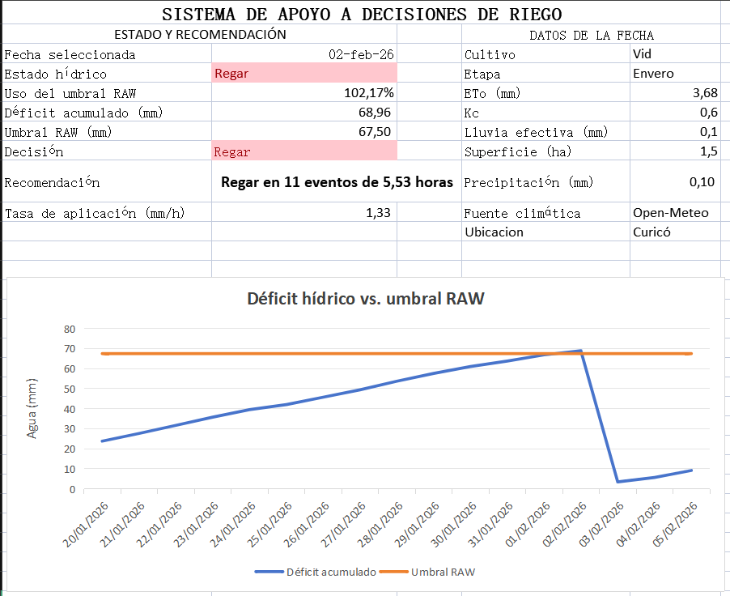

# Sistema Inteligente de Apoyo al Riego

Prototipo desarrollado con **Python, Excel/WPS y datos meteorológicos de Open-Meteo** para apoyar decisiones de riego a partir de variables climáticas, del cultivo, del suelo y del sistema de riego.

El sistema descarga automáticamente información meteorológica, actualiza el balance hídrico y genera una recomendación operacional de riego.

## Vista del sistema



## Objetivo

Transformar datos climáticos y parámetros agronómicos en una recomendación de riego clara, interpretable y operativa.

El sistema busca responder preguntas como:

- ¿Es necesario regar?
- ¿Cuál es el déficit hídrico acumulado?
- ¿Se alcanzó el umbral de riego?
- ¿Cuánta agua debe aplicarse?
- ¿Cuántas horas de riego son necesarias?
- ¿Es necesario dividir el riego en varios eventos?

## Funcionamiento

El flujo general del sistema es:

```text
Parámetros configurados en Excel
        ↓
Lectura de parámetros desde Python
        ↓
Geocodificación de la ubicación
        ↓
Consulta de datos meteorológicos en Open-Meteo
        ↓
Obtención de ETo y precipitación diaria
        ↓
Actualización automática del archivo Excel
        ↓
Cálculo del balance hídrico
        ↓
Cálculo de TAW y RAW
        ↓
Evaluación de la necesidad de riego
        ↓
Cálculo de volumen y tiempo de aplicación
        ↓
Actualización del panel y del gráfico
```

Python también reconstruye automáticamente el gráfico del panel después de actualizar los datos.

## Tecnologías utilizadas

- Python
- Open-Meteo API
- Excel / WPS Spreadsheet
- openpyxl
- requests

## Cómo utilizar el sistema

1. Abrir el archivo:

```text
Sistema_Riego_Inteligente_demo.xlsx
```

2. Ir a la hoja `parametros` y configurar los valores deseados.

Entre los principales parámetros se encuentran:

- ubicación
- fecha de inicio
- fecha de término
- déficit hídrico inicial
- cultivo
- etapa fenológica
- superficie
- eficiencia de riego
- caudal disponible
- tipo de suelo
- profundidad radicular
- fracción de agotamiento `p`
- duración máxima por evento de riego

3. Guardar y cerrar el archivo Excel.

4. Ejecutar el script desde la carpeta del proyecto:

```bash
python descargar_clima.py
```

5. El programa:

- lee los parámetros configurados en Excel;
- obtiene las coordenadas de la ubicación;
- descarga los datos meteorológicos;
- genera un archivo CSV con los datos climáticos;
- actualiza la hoja `clima_real`;
- actualiza el balance hídrico;
- calcula la necesidad de riego;
- reconstruye el gráfico del panel;
- guarda nuevamente el archivo Excel.

6. Abrir nuevamente:

```text
Sistema_Riego_Inteligente_demo.xlsx
```

7. Ir a la hoja `panel` para revisar los resultados y la recomendación de riego.

## Variables utilizadas

El sistema considera variables climáticas, agronómicas, edáficas y operacionales.

### Clima

Actualmente se utilizan:

- evapotranspiración de referencia (ETo);
- precipitación diaria.

Los datos meteorológicos son obtenidos mediante Open-Meteo.

### Cultivo

El sistema utiliza:

- cultivo;
- etapa fenológica;
- coeficiente de cultivo (Kc);
- profundidad radicular.

### Suelo

Se consideran:

- contenido de agua a capacidad de campo;
- contenido de agua en punto de marchitez permanente;
- agua total disponible (TAW);
- agua fácilmente aprovechable (RAW).

### Sistema de riego

Se consideran:

- superficie;
- eficiencia de riego;
- caudal disponible;
- duración máxima por evento.

## Balance hídrico

La evapotranspiración del cultivo se calcula como:

```text
ETc = ETo × Kc
```

El déficit hídrico diario considera la evapotranspiración del cultivo y la precipitación efectiva.

El sistema mantiene memoria del déficit entre días, permitiendo observar su acumulación hasta alcanzar el umbral definido para activar el riego.

## Agua disponible en el suelo

El agua total disponible en la zona radicular se estima mediante:

```text
TAW = 1000 × (θCC - θPMP) × profundidad radicular
```

donde:

```text
θCC  = contenido de agua a capacidad de campo
θPMP = contenido de agua en punto de marchitez permanente
```

El agua fácilmente aprovechable se calcula como:

```text
RAW = p × TAW
```

Cuando el déficit acumulado alcanza o supera el valor de RAW, el sistema genera una recomendación de riego.

## Cálculo del riego

Cuando se activa la decisión de riego, el sistema calcula:

- riego neto;
- riego bruto;
- volumen de agua a aplicar;
- tiempo total de riego;
- número de eventos necesarios;
- duración de cada evento.

Esto permite transformar el balance hídrico en una recomendación operacional.

Por ejemplo:

```text
Regar en 11 eventos de 5,53 horas
```

## Panel de resultados

El panel permite visualizar de forma resumida:

- estado hídrico;
- porcentaje de uso de RAW;
- déficit acumulado;
- umbral RAW;
- decisión de riego;
- recomendación operacional;
- tasa de aplicación;
- cultivo;
- etapa fenológica;
- ETo;
- Kc;
- precipitación;
- precipitación efectiva;
- superficie;
- ubicación;
- fuente de los datos meteorológicos.

El gráfico muestra la evolución del déficit hídrico y su relación con el umbral RAW.

## Supuestos y limitaciones

Este proyecto corresponde a un prototipo de apoyo a decisiones y todavía presenta algunas simplificaciones.

- El sistema está actualmente orientado principalmente a vid.
- Los valores de Kc utilizados son referenciales y requieren calibración para condiciones locales.
- Los parámetros de suelo incluidos son demostrativos y pueden ser reemplazados por valores medidos o provenientes de fuentes técnicas.
- Actualmente la precipitación efectiva se aproxima como igual a la precipitación registrada.
- El balance hídrico se realiza a escala diaria.
- No se incorporan todavía sensores de humedad del suelo.
- No se modelan explícitamente escorrentía, percolación profunda ni restricciones de infiltración.
- Los datos meteorológicos provienen de Open-Meteo.
- La herramienta está diseñada como un sistema de apoyo a decisiones y no como sustituto de una recomendación agronómica validada en terreno.

## Próximas mejoras

El proyecto puede extenderse mediante:

- incorporación de parámetros de suelo provenientes de fuentes técnicas;
- soporte para múltiples cultivos;
- tablas de Kc específicas por cultivo y etapa;
- incorporación de pronósticos meteorológicos;
- mejora del cálculo de precipitación efectiva;
- integración con sensores de humedad del suelo;
- incorporación de restricciones de infiltración;
- almacenamiento histórico de decisiones de riego;
- comparación de distintos escenarios de manejo;
- desarrollo de un dashboard más avanzado.

## Estructura del proyecto

```text
Sistema_Riego_Inteligente_GitHub/
│
├── README.md
├── descargar_clima.py
├── Sistema_Riego_Inteligente_demo.xlsx
├── requirements.txt
│
└── imagenes/
    └── panel_riego.png
```

Durante la ejecución también se genera automáticamente un archivo CSV con los datos meteorológicos correspondientes al período seleccionado.

## Instalación

Para ejecutar el proyecto se requiere Python y las dependencias incluidas en:

```text
requirements.txt
```

Se pueden instalar ejecutando:

```bash
pip install -r requirements.txt
```

## Estado del proyecto

**Versión funcional de demostración.**

Actualmente el sistema permite modificar la ubicación, el período de análisis, parámetros del cultivo, propiedades del suelo y características del sistema de riego.

Después de ejecutar el script de Python, los datos climáticos, los cálculos y el gráfico se actualizan automáticamente.